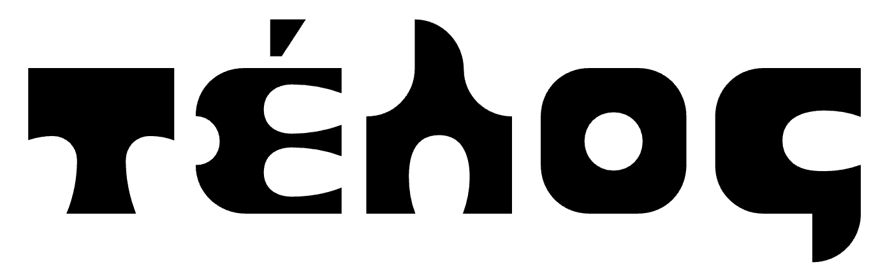

# télos (τέλος)

<p align="center">
  
</p>

<p align="center">
  <a href="https://telos.wingit.tech"><strong>telos.wingit.tech</strong></a>
  · <a href="https://github.com/kazenoko-git/telos">GitHub</a>
  · <a href="https://pypi.org/project/telos-ml/">PyPI</a>
</p>

**Train language models, then benchmark what they learned.** Télos brings data preparation, training workflows, and model evaluation together, with support for autoregressive and discrete-diffusion research across Apple Silicon, NVIDIA GPUs, and Google Cloud TPUs.

## Why choose Télos?

Télos is for people who want to run and study language-model training processes. Prepare data, configure pretraining or post-training, choose an objective and backend, then evaluate the resulting model in the same toolkit. Model-size and token budgets help configure a run alongside architecture, batching, and training settings.

Télos covers corpus preparation, pretraining, supervised fine-tuning (SFT), direct preference optimization (DPO), and model evaluation. Pretraining includes autoregressive (AR), masked diffusion (MDLM), uniform-noise diffusion (UNDLM), and COROSred objectives. Full-parameter, LoRA and QLoRA SFT/DPO operate on native causal Télos checkpoints. Training paths target Apple Silicon through MLX, NVIDIA GPUs through PyTorch/CUDA, Google Cloud TPUs through PyTorch-XLA, and CPU for compatible workflows. Its evaluation suite includes contextual code probes, executable code tasks, reasoning, tool use, cybersecurity, and other task suites.

Resume includes optimizer state, random generators, data position, and frozen DPO reference weights. CUDA post-training supports multiple GPUs, and distributed pretraining resume validates worker topology and per-rank checkpoints. The v1.7.1 Colab artifacts cover short single-device runs with an external TPU bounds workaround; their performance and full-state resume claims need corrected reruns. v1.7.2 fixes native CUDA precision selection, verified single-chip TPU launch setup, NF4 saved-weight retention and post-training host RNG seeding. See the [audited validation status and rerun commands](docs/releases/v1.7.2-validation.md); physical v1.7.2 CUDA/TPU and multi-rank validation remain pending.

### How it compares

Télos overlaps with general training toolkits, focused end-to-end training projects, and Apple Silicon training stacks. The best fit depends on whether you need a particular training workflow, research flexibility, or a standard evaluation ecosystem.

| Tool | Workflow overlap | What to compare with Télos |
| :--- | :--- | :--- |
| [LitGPT](https://github.com/Lightning-AI/litgpt) | PyTorch pretraining, continued pretraining, fine-tuning, and evaluation across supported model architectures; integrates LM Evaluation Harness. | Matched training workloads, time to a validation target, and scoring agreement on shared evaluation tasks. |
| [nanochat](https://github.com/karpathy/nanochat) | An end-to-end GPT-style pipeline spanning tokenizer training, base training, chat stages, and evaluation. | Complete training workflows and time to a common quality target. |
| [MLX Examples](https://github.com/ml-explore/mlx-examples) / [MLX-Pretrain](https://github.com/N8python/mlx-pretrain) | Apple Silicon training examples and MLX pretraining workflows. | Local training throughput, memory, and validation quality with a matched model and corpus. |
| [MLX-LM](https://github.com/ml-explore/mlx-lm) | Local model execution and fine-tuning on Apple Silicon. | Supported post-training workloads and external-model evaluation integration. |
| [Unsloth](https://unsloth.ai/docs) | Fine-tuning, continued pretraining, full pretraining, and RL workflows on supported models. | Equivalent supported training methods, resource use, and resulting model quality. |
| [Axolotl](https://docs.axolotl.ai/) | Configurable fine-tuning and post-training recipes. | Equivalent SFT/DPO workloads, checkpoint handling, and resulting model quality. |

Télos's evaluation suite is not limited to Télos-trained models. It can evaluate external models through supported adapters and run both custom tasks and public benchmark suites. For standardized public scores, LitGPT's LM Evaluation Harness integration and standalone harnesses such as [LightEval](https://huggingface.co/docs/lighteval/main/index) offer large task catalogs and established comparison workflows. Télos adds its own domain-focused suites, including sandboxed functional code evaluation. Benchmark data is generated or fetched separately from the evaluator; this is a setup requirement, not a missing evaluation capability.

These are workflow comparisons. Matched competitor training runs and evaluator parity checks have not yet established a Télos speed, memory, or quality advantage.

## What you can do with Télos

- **Get from corpus to training run:** prepare text, code, JSONL, or Hugging Face datasets as token streams, then train with a parameter budget and token target instead of assembling a training stack by hand.
- **Continue from pretraining to post-training:** fine-tune causal Télos checkpoints on prompt/response JSONL or preference pairs, with output checkpoints that work with Télos evaluation tools.
- **Resume interrupted training:** restore complete pretraining or SFT/DPO state from a compatible checkpoint. Exported model weights can initialize a new run; resuming an existing run requires its training-state checkpoint.
- **Run on the hardware you have:** use Apple Silicon through MLX, NVIDIA GPUs through PyTorch/CUDA, Google Cloud TPUs through PyTorch-XLA, or CPU for compatible workflows.
- **Benchmark trained and external models:** run custom and public task suites for contextual code behavior, sandboxed code execution, reasoning, tool-use, cybersecurity, and other domains; inspect and save per-task results. Some suites must first be generated or fetched with the benchmark builder.
- **Measure training throughput:** use the separate `telos bench` command for short hardware-throughput measurements. This is distinct from evaluating model quality on benchmark tasks.

## Get started

Install the package:

```bash
pip install --upgrade telos-ml
```

For Apple Silicon MLX support, install the optional extra:

```bash
pip install --upgrade "telos-ml[mlx]"
```

Prepare a corpus and start an autoregressive training run:

```bash
telos dataprep --corpus ./my_text_or_code --output data/corpus.bin
telos pretrain --paradigm ar --params 50M --tokens 300M --data data/corpus.bin \
  --checkpoint-dir checkpoints/ar
```

Resume pretraining using the saved configuration and original total training budget:

```bash
# Apple Silicon / MLX: complete training state, separate from exported weights
telos pretrain --resume checkpoints/ar/checkpoint_step_1000.resume.npz

# PyTorch: CPU, CUDA, or XLA with the original worker topology
telos pretrain --resume checkpoints/ar/checkpoint_step_1000.pt
```

Resume validates corpus and tokenizer fingerprints. Keep all distributed rank files together and use the original backend and worker topology. Legacy weights-only checkpoints cannot restore the optimizer or data cursor; use `--init-checkpoint` to start a new pretraining run from those weights.

Post-train a pretrained causal checkpoint with SFT or DPO. Passing the checkpoint directory selects its final native weights:

```bash
telos posttrain --method sft --checkpoint checkpoints/ar \
  --data data/instructions.jsonl --output checkpoints/ar-sft
telos posttrain --method dpo --checkpoint checkpoints/ar-sft \
  --data data/preferences.jsonl --output checkpoints/ar-dpo
```

SFT JSONL records use `prompt` and `response` string fields. DPO records use `prompt`, `chosen`, and `rejected`. Use a PyTorch `.pt` checkpoint for CUDA or XLA, and a native MLX or PyTorch checkpoint for MLX. PyTorch MPS is not used. `telos train` remains an alias for `telos pretrain`.

Resume SFT or DPO by repeating the original run options and adding its complete training-state checkpoint:

```bash
telos posttrain --method sft --checkpoint checkpoints/ar \
  --data data/instructions.jsonl --output checkpoints/ar-sft \
  --resume checkpoints/ar-sft/checkpoint_step_250.resume.npz
```

This example uses MLX state; CPU/CUDA/XLA post-training uses `.resume.pt` instead of `.resume.npz`. DPO resume also restores the original frozen reference model. Keep the original data, tokenizer, method, and training settings.


### LoRA and QLoRA (v1.7.0)

Use the same SFT/DPO commands with `--finetune lora` or `--finetune qlora`:

```bash
telos posttrain --method sft --checkpoint checkpoints/ar \
  --data data/instructions.jsonl --output checkpoints/ar-lora \
  --finetune lora --lora-rank 16 --lora-alpha 32

telos posttrain --method dpo --checkpoint checkpoints/ar-sft \
  --data data/preferences.jsonl --output checkpoints/ar-qlora \
  --finetune qlora --hardware mlx

# CUDA: one worker per GPU; batch-size is per worker under torchrun.
torchrun --standalone --nproc-per-node=2 -m telos posttrain \
  --hardware cuda --method sft --checkpoint checkpoints/ar \
  --data data/instructions.jsonl --output checkpoints/ar-lora-cuda \
  --finetune lora --batch-size 4
```

All transformer attention/MLP projections are adapted by default; embeddings, output head and base weights stay frozen. `--lora-targets` accepts projection suffixes (PyTorch: `q_proj,v_proj`; MLX: `qkv_proj`). `--lora-dropout` defaults to zero. Adapter weights are FP32.

PyTorch QLoRA stores frozen projections as packed blockwise NF4, with a portable dequantize/matmul path for CPU, CUDA and XLA. MLX uses native grouped affine 4-bit quantized matmul; projection input widths must be divisible by 64. PyTorch recomputes dequantized frozen projections during backward to avoid retaining dense matrices for input gradients. These are distinct quantization formats. This implementation does not include double quantization or paged optimizers, and does not claim fused CUDA-kernel performance. Embeddings and output heads remain unquantized.

Each save produces a merged native model for ordinary evaluation, an adapter-only artifact, and complete `.resume.pt`/`.resume.npz` state. Resume with the **original base checkpoint**, original options and full resume artifact; merged exports are for evaluation or starting a new run. DPO resume restores its frozen reference. New resume identities include the base hash, adapter, precision, compilation and cache settings; older post-training resume files do not match v1.7 settings.

CUDA/XLA `--precision auto` chooses BF16 where natively supported (CUDA otherwise uses scaled FP16); `--precision float32` opts out. MLX auto preserves the loaded parameter dtype. MLX compiles the update by default; CUDA compiles the model. Use `--no-compile` to opt out. DPO reference caching is bounded by `--reference-cache-size` (128 batches by default); `--no-cache-reference` disables it. MLX reuses individual response scores across reshuffled batches, with an equivalent budget of `2 × batch_size × reference_cache_size` host scalars. Scores are recomputed after resume; batch padding width is part of the cache identity. XLA always pads to the configured maximum length for stable shapes; `--padding batch` is available on CPU/CUDA/MLX.

MLX pretraining uses bounded asynchronous gradient accumulation by default. Use `--no-async-accumulation` (or `training.async_accumulation: false`) for synchronous accumulation. The eager memory policy and stage profiler keep their synchronous fences. See [v1.7.6 validation](docs/releases/v1.7.6-validation.md) for measured gains and limits.

Pretraining supports opt-in `--packed-projections` on PyTorch, `--experimental-qkv-rope` on MLX, and `--fused-vocab-loss --fused-vocab-chunk-size 256` for tiled AR loss on both. MLX additionally accepts `--fused-vocab-chunk-axis token` (default: `vocab`). These MLX projection/loss paths are experimental: BF16 gradient reductions can change, and the measured compiled head workloads used more memory and ran slower than the full projection. They remain disabled by default; tiling alone does not guarantee lower peak allocation. See [the measured limits](reports/mlx_fusion_2026-11-16/REPORT.md). Choose activation checkpointing explicitly with `--gradient-checkpointing auto|on|off`. Benchmark JSON reports synchronized completed-update timing, five excluded warmup updates, input-token units and whether enough updates were measured.

MLX pretraining now chooses a fitting microbatch within 60% of system RAM,
including at least 1 GiB of headroom, and preserves the effective batch through
variable accumulation. See [memory planning](docs/mlx-memory-planning.md) for
estimation limits, checkpointing policy and measured tuning.

See [v1.7 optimization and validation notes](docs/optimization-v1.7.0.md) for hardware limits and local evidence.

Evaluation suite preparation uses scripts from the source repository. If you installed only the package, first obtain a matching source checkout:

```bash
git clone https://github.com/kazenoko-git/telos.git
cd telos
git checkout v1.7.0
```

Build or fetch the datasets as needed, then evaluate your checkpoint. Relative checkpoint paths below are resolved from the repository directory:

```bash
python scripts/build_evaluation_benchmarks.py --all
telos eval --checkpoint checkpoints/ar/checkpoint_final.pt --type all --mode full
```

For a native MLX run, use `checkpoints/ar/model.safetensors`. Functional Python, JavaScript, and Rust execution requires the supported OS sandbox; execution fails closed when that sandbox is unavailable. Required language runtimes must also be installed; structural checks alone do not count as functional passes.

Run the short hardware benchmark separately:

```bash
telos bench --paradigm ar --params 50M --hardware mlx
```

Explore the CLI with `telos --help` or see the [CLI guide](cli/README.md) for data preparation, training, evaluation, and hardware benchmark options.

### Python API

```python
from telos.models import TelosConfig, TelosTransformer

config = TelosConfig(
    vocab_size=8192,
    d_model=512,
    n_layers=8,
    n_heads=8,
    n_kv_heads=8,
    max_seq_len=512,
    is_causal=True,
)
model = TelosTransformer(config)
```

## Research with Télos

Télos supports experiments in autoregressive language modeling and discrete diffusion, including masked and uniform-noise diffusion. The research program has examined training data budgets, scaling behavior, positional encodings, and evaluation methods. The current training and research mainline is autoregressive modeling.

Browse the [research index](research/README.md) for papers, reports, and experiment notes. See [deployment and hardware guidance](DEPLOYMENT.md) for setup details.

## Evaluation display

Turn saved results into an offline cream evaluation notebook, with searchable cases, category scores, and inspectable evidence:

```sh
telos eval report logs/evaluation.json --output reports/evaluation.html
# Or save the notebook as a run completes:
telos eval --checkpoint path/to/checkpoint --mode functional --html-report reports/evaluation.html
```

Live terminal progress adapts to terminal width and emits plain records in CI. See the [evaluation display guide](docs/evaluation-display.md) for supported reports, filters, exports, and `--display auto|plain|off`.

## Model evaluations

The historical archive contains five local model evaluations across seven suites, with **3,147 task IDs per model**. The table below uses the [audited per-task outcomes](reports/public_evaluations_2026-10-28/REPORT.md), which correct older summary values and task counts.

**These are recorded success rates, not a controlled pass@1 leaderboard.** Some saved reports include successful selective retries; generation budgets, prompts, and answer extraction differed between models. The audit checks archive consistency, not every scorer or historical model configuration.

| Suite | Tasks | Apple AFM default | Ternary Bonsai 4B | IBM Granite | LiquidAI LFM | Google Gemma |
| :--- | ---: | ---: | ---: | ---: | ---: | ---: |
| HumanEval | 164 | 62.80% | 71.95% | 60.37% | 45.73% | 82.32% |
| Télos tool-use | 30 | 73.33% | 63.33% | 70.00% | 63.33% | 80.00% |
| Télos cybersecurity | 50 | 12.00% | 16.00% | 22.00% | 24.00% | 56.00% |
| GPQA Diamond | 198 | 39.39% | 26.77% | 28.79% | 20.71% | 43.94% |
| MMLU Science selection | 833 | 69.75% | 62.55% | 61.82% | 73.11% | 58.58% |
| Competition MATH selection | 700 | 52.00% | 56.71% | 64.71% | 43.57% | 67.14% |
| ARC-Challenge | 1,172 | 85.32% | 54.61% | 86.60% | 59.56% | 66.72% |

Apple's historical bridge selected the system-default model; the earlier “Core Advanced” variant label was unverified. Tool-use is Télos's local 30-task suite, not an official BFCL score. MMLU and MATH use selections of their parent benchmarks. See the [archive report](reports/public_evaluations_2026-10-28/REPORT.md) for model identity, quantization evidence, retry markers, and scoring limits.

Télos evaluates external models as well as its own checkpoints. These historical model results do not measure the performance of Télos against competing training systems or evaluation harnesses. `telos bench` separately measures training throughput.

## Project guides

| Guide | What it covers |
| :--- | :--- |
| [CLI guide](cli/README.md) | Data preparation, training, evaluation, and hardware benchmarking |
| [Research index](research/README.md) | Papers, scaling studies, and architecture notes |
| [Benchmark reports](benchmarks/README.md) | Model comparisons, evaluation details, and performance measurements |

## Citation

```bibtex
@article{samuel2026telos,
  title   = {télos: Exploring Scaling Laws, Hardware Optimizations, and Paradigm Trade-offs in Discrete Diffusion and Autoregressive Language Models},
  author  = {Ivan Samuel},
  journal = {Wing It Research},
  year    = {2026},
  url     = {https://telos.wingit.tech}
}
```

## License

Apache-2.0. See [LICENSE](LICENSE).

## Packaged document evaluation

The frozen 512-case document diagnostic suite ships in Télos 1.6.2. Replay the completed historical responses offline:

```bash
telos eval documents replay --reference --output replay.json --html-report replay.html
```

Run new predictions using existing generic backends with `telos eval --suite document512 --model MODEL --backend openai_api --api-base http://localhost:1234/v1 --track all --output run.json`. Direct QA, exact source extraction and the configured calculator remain separate metrics. See [document evaluation](https://github.com/kazenoko-git/telos/blob/v1.6.2/docs/document-evaluation.md) for model setup, revision pins and imported responses.
