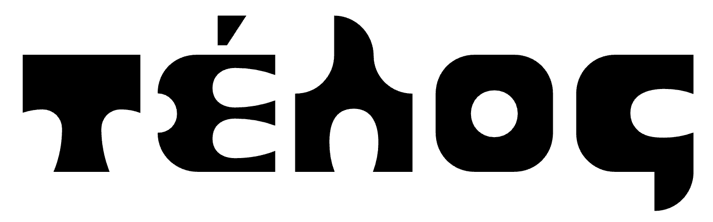
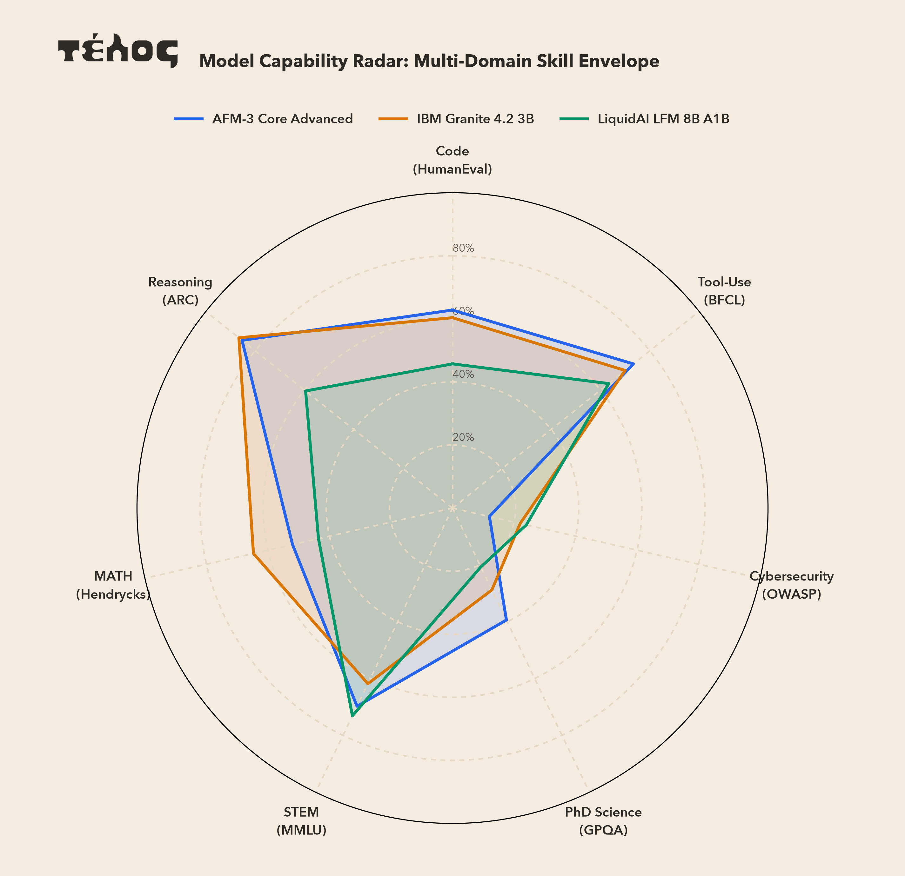

# télos (τέλος)

<p align="center">
  
</p>

<p align="center">
  <a href="https://telos.wingit.tech"><strong>telos.wingit.tech</strong></a>
  · <a href="https://github.com/kazenoko-git/telos">GitHub</a>
  · <a href="https://pypi.org/project/telos-ml/">PyPI</a>
</p>

**Build, train, and evaluate language models with one Python toolkit.** Télos helps developers and researchers prepare text data, run autoregressive or discrete-diffusion experiments, and compare model behavior across hardware backends.

## Why choose Télos?

Use Télos when the goal is to **run controlled language-model experiments**, especially when you want the same project to handle data preparation, training, and evaluation. Set a parameter budget, token budget, and hardware target from the CLI; then compare autoregressive training with discrete-diffusion approaches and evaluate checkpoints with the included suites.

Télos is most useful when you want to:

- **Study training choices, not just consume pretrained models:** the codebase includes autoregressive, masked-diffusion, and uniform-noise-diffusion training paths, with AR as the current research mainline.
- **Keep experiments in one workflow:** prepare corpora, train, benchmark throughput, and evaluate checkpoints through the same Python package and CLI.
- **Use different compute you already have:** target Apple Silicon (MLX), NVIDIA GPUs (CUDA), or Google Cloud TPUs (XLA), with CPU available for compatible workflows.
- **Compare more than loss:** combine contextual probes with functional code execution and task-specific suites, then save reports for inspection.

### How it compares

These tools overlap in model training, but serve different priorities. Télos is a good fit when the experiment itself—training objective, data budget, backend, and evaluation—is the product.

| Tool | Strong fit | Choose Télos when… |
| :--- | :--- | :--- |
| [Hugging Face Transformers](https://huggingface.co/docs/transformers) | A broad library of pretrained models and architectures for inference and training across text, vision, audio, video, and multimodal tasks. | You want a focused research workflow for training small language models across AR and discrete-diffusion objectives, with data prep and evaluation in the same package. |
| [LitGPT](https://github.com/Lightning-AI/litgpt) | Recipes to pretrain, fine-tune, and deploy a range of high-performance LLMs. | Your question is about comparing training paradigms and scaling choices across MLX, CUDA, or TPU, rather than adapting a catalog of existing LLMs. |
| [nanoGPT](https://github.com/karpathy/nanoGPT) | A compact, hackable implementation for training and fine-tuning GPT models. | You want a more integrated CLI for data preparation, dimensional model setup, multi-backend training, and multi-domain evaluation. |

If your main task is fine-tuning a popular pretrained model, a model-hub or fine-tuning focused tool may fit better. Télos is aimed at people who want to inspect and compare how training choices affect their own small-model experiments.

## What you can do with Télos

- **Get from corpus to training run:** prepare text, code, JSONL, or Hugging Face datasets as token streams, then train with a parameter budget and token target instead of assembling a training stack by hand.
- **Run on the hardware you have:** use Apple Silicon through MLX, NVIDIA GPUs through PyTorch/CUDA, Google Cloud TPUs through PyTorch-XLA, or CPU for compatible workflows.
- **Compare model behavior:** run contextual probes, code execution, reasoning, tool-use, cybersecurity, and other evaluation suites; save reports for later analysis.

## Get started

Install the package:

```bash
pip install telos-ml
```

For Apple Silicon MLX support, install the optional extra:

```bash
pip install "telos-ml[mlx]"
```

Prepare a corpus and start an autoregressive training run:

```bash
telos dataprep --corpus ./my_text_or_code --output data/corpus.bin
telos train --paradigm ar --params 50M --tokens 300M --data data/corpus.bin
```

Explore the CLI with `telos --help` or see the [CLI guide](cli/README.md) for data preparation, training, evaluation, and hardware benchmark options.

### Python API

```python
from telos.models import TelosConfig, TelosTransformer

config = TelosConfig(
    vocab_size=8192,
    d_model=512,
    n_layers=8,
    n_heads=8,
    n_kv_heads=8,
    max_seq_len=512,
    is_causal=True,
)
model = TelosTransformer(config)
```

## Research with Télos

Télos supports experiments in autoregressive language modeling and discrete diffusion, including masked and uniform-noise diffusion. The research program has examined training data budgets, scaling behavior, positional encodings, and evaluation methods. The current training and research mainline is autoregressive modeling.

Browse the [research index](research/README.md) for papers, reports, and experiment notes. See [deployment and hardware guidance](DEPLOYMENT.md) for setup details.

## Model evaluations

We evaluated three compact models across seven suites. Scores below are Pass@1; the macro average gives each suite equal weight. These results describe the evaluated configurations and suites, not a universal ranking of the models.

| Suite | Tasks | Apple AFM-3 Core Advanced | IBM Granite 4.2 3B | LiquidAI LFM 8B A1B |
| :--- | ---: | ---: | ---: | ---: |
| HumanEval | 164 | **62.80%** | 60.37% | 45.73% |
| BFCL tool-use | 30 | **73.33%** | 70.00% | 63.33% |
| Cybersecurity auditing | 50 | 12.00% | 22.00% | **24.00%** |
| GPQA Diamond | 198 | **39.39%** | 28.79% | 20.71% |
| MMLU Science | 119 | 69.75% | 61.82% | **73.11%** |
| Competition MATH | 140 | 52.00% | **64.71%** | 43.57% |
| ARC-Challenge | 150 | 85.32% | **86.60%** | 59.56% |
| **Macro average** | **841** | **56.37%** | **56.33%** | **47.14%** |

<p align="center">
  
</p>

The full [benchmark report](benchmarks/README.md) includes methods, throughput and memory measurements, repetition analysis, and per-model reports.

## Project guides

| Guide | What it covers |
| :--- | :--- |
| [CLI guide](cli/README.md) | Data preparation, training, evaluation, and hardware benchmarking |
| [Research index](research/README.md) | Papers, scaling studies, and architecture notes |
| [Benchmark reports](benchmarks/README.md) | Model comparisons, evaluation details, and performance measurements |

## Citation

```bibtex
@article{samuel2026telos,
  title   = {télos: Exploring Scaling Laws, Hardware Optimizations, and Paradigm Trade-offs in Discrete Diffusion and Autoregressive Language Models},
  author  = {Ivan Samuel},
  journal = {Wing It Research},
  year    = {2026},
  url     = {https://telos.wingit.tech}
}
```

## License

Apache-2.0. See [LICENSE](LICENSE).
