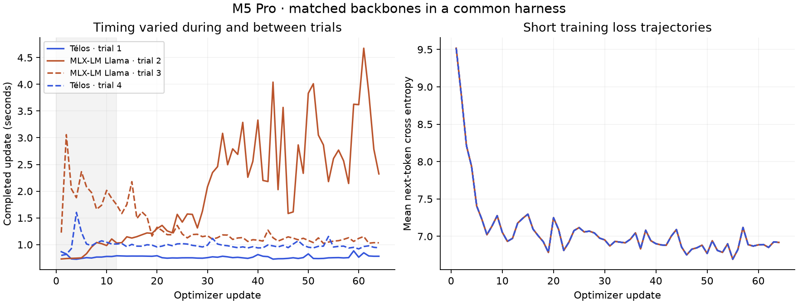

# First M5 Pro competitor tests

14 November 2026. Apple M5 Pro, 24 GB unified memory, AC power, MLX 0.32.2.

**The first controlled backbone comparison and both native workflow smokes
completed. The timing variation does not support a reliable speed-lead claim.**
Native LitGPT/nanochat training and evaluation-harness parity have not run yet.

## Controlled backbone comparison

Télos v1.5.5's production MLX backbone was compared with MLX-LM 0.32.2's Llama
backbone, the architecture implementation loaded by MLX-Pretrain. This uses
one shared benchmark loop, not the two native toolkit trainers.

Both sides used 49,166,848 parameters, identical mapped initialization, the
same real-corpus token prefix, BF16 model tensors, FP32 master weights and
AdamW moments, and the same cross-entropy, clipping, learning rate and decay.
Sequence length was 256, microbatch 8, accumulation 8. Each of four fresh
processes completed 64 updates; the first 12 were excluded from throughput.
The experiment processed 4,194,304 training input tokens.

| Trial order | Implementation | Warmed input tokens/s | Peak MLX allocation | Final held-out loss |
|---|---|---:|---:|---:|
| A1 | Télos | 21,352 | 2.410 GiB | 6.803463 |
| B1 | MLX-LM Llama | 7,043 | 2.230 GiB | 6.802844 |
| B2 | MLX-LM Llama | 13,735 | 2.227 GiB | 6.802695 |
| A2 | Télos | 16,722 | 2.410 GiB | 6.803438 |

All four started with the same BF16 held-out loss, 9.5229206. The prerequisite
small-model FP32 check produced identical logits and loss; maximum per-tensor
gradient relative L2 error was 3.743e-5. This is a measured equivalence check for
the tested small shape, not proof for every shape or training trajectory.

Télos used about 8.2% more peak MLX allocation in this common loop. Short final
losses were close; they do not establish equivalent long-run model quality.
Validation covers only eight adjacent held-out sequences from the same corpus.

### Why the pooled speed difference is exploratory

Télos's two throughput observations differ by 1.28×; MLX-LM's differ by 1.95×.
The latter also slowed substantially within one trial. Whole-machine memory
conditions changed during the experiment, and the machine was not isolated
from other applications. No thermal/performance warning was reported by
`pmset`, which is not a direct proof of constant clocks or absent contention.

The raw pooled rates are retained in [summary.json](pairs/summary.json) for
auditability. Their approximately 2× ratio must not be marketed as a Télos
speedup: this experiment does not isolate implementation effects from the
changing host conditions. A quieter, instrumented repetition is needed.

The shared loop also differs from native Télos training: it uses a common
FP32 cross-entropy, FP32 gradient accumulation, and no special-token masking.
It does not exercise either toolkit's checkpoint/resume or evaluator. Earlier
Télos optimization rates around 38–49k tokens/s used different loops/options
and cannot be substituted into this table.

## Native workflow smokes

### Télos

The actual v1.5.5 training entry point completed eight AR updates on the real
binary corpus, 16,384 input tokens, and exported both `model.safetensors` and
`checkpoint_final.resume.npz`. The run used its normal 49,166,848-parameter
BF16 model and FP32 masters. The existing profiler reported completion without
memory-guard errors. Its wall time was 15.63 seconds, including initialization
and checkpoint work; this is not warmed throughput.

[Native Télos evidence](native_telos/summary.json) includes per-update timings,
system telemetry, saved configuration, console output, and artifact hashes.
Large weight/state files remain local. This smoke verifies artifact creation;
it does not independently test restoring those artifacts.

### MLX-Pretrain

The unmodified pinned upstream `Trainer` completed eight updates, validation,
and model/optimizer/state checkpoint writing. The verification rerun reduced
held-out loss from 8.774558 to 6.717516 in 4.46 seconds end to end.

The native tokenizer has 4,096 entries, so the actual native model contains
47,069,696 parameters and uses FP32. The wrapper decodes a local corpus slice
to text; upstream retokenizes, inserts BOS/EOS, pads and shuffles documents.
Its batching, optimizer schedule, loss masking and initialization therefore
differ from the Télos native smoke. **The native wall times and validation
losses are not a head-to-head performance comparison.**

[Native upstream evidence](native_mlx_pretrain_verified/result.json) records
188 MB of model weights plus 377 MB of optimizer tensors written locally.
The observed 3.213 GiB peak exceeded MLX's advisory 3.2 GiB allocation setting;
that setting is not a hard OS limit. The run completed. An earlier identical
smoke peaked at 3.136 GiB and produced essentially the same validation loss.

## Next experiments

1. Repeat controlled backbone timing with per-update host/GPU telemetry and
   stable memory conditions; keep default and experimental Télos options separate.
2. Match native MLX-Pretrain/Télos corpus handling, token counts, precision,
   initialization and training budget before comparing time to validation quality.
3. Run nanochat's supported MPS path in its declared PyTorch 2.9.1 environment,
   with explicit MPS timing synchronization. Verify LitGPT MPS placement and
   precision separately. See [device notes](DEVICE_NOTES.md).
4. Compare evaluation harnesses using common saved completions and task IDs;
   test scoring/execution agreement separately from model generation speed.

## Reproduction

See [protocol](PROTOCOL.md), [commands and timing boundaries](REPRODUCE.md),
[environment lock](requirements.lock.txt), and [source pins](upstream_manifest.json).
All successful runs, the initial benchmark-script smoke failure, and its fix
are committed separately. No production model/trainer code was changed.
