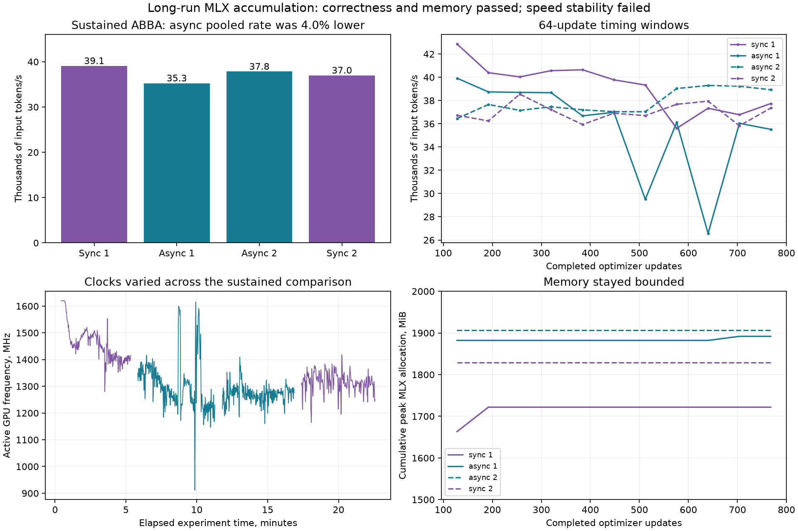

# Sustained MLX accumulation comparison — 2026-11-17

Release update: async was subsequently enabled by default for v1.7.6 following
the release decision. See [release validation](../docs/releases/v1.7.6-validation.md).
The measurements and decision at the time of this report are preserved below.

Follow-up: [randomized clock/thermal comparison](mlx_clock_controlled_2026-11-17.md)
found a positive async effect with insufficient strict-match coverage. The results
below retain the original separate-process observations.

**Decision: keep asynchronous accumulation off by default and hold v1.7.6.**
The sustained comparison did not reproduce a stable speedup. Correctness and
memory stability passed, but async was 4.0% slower in the pooled measurement,
with opposite signs in the two adjacent comparisons. Clock differences confound
attribution; this is a failed promotion gate, not proof of a universal regression.

## Completed comparison

Four fresh processes ran 768 optimizer updates each in synchronous/asynchronous/
asynchronous/synchronous order, with the first 64 updates excluded from timing.
This totals 3,072 updates and 50,331,648 input tokens. Each run lasted roughly
5–6 minutes including startup and end-of-run saves; full-state serialization is
outside the measured step intervals. There was no Instruments trace or competing
training benchmark. Normal desktop activity was not stopped.

| Order | Mode | Warmed input tok/s | Mean active GPU MHz | Peak MLX MiB |
|---|---|---:|---:|---:|
| 1 | Synchronous | 39,086 | 1,460 | 1,722 |
| 2 | Async | 35,258 | 1,304 | 1,892 |
| 3 | Async | 37,836 | 1,272 | 1,906 |
| 4 | Synchronous | 36,990 | 1,317 | 1,828 |

The first adjacent comparison favored synchronous by 9.8%. In the reverse
comparison async was 2.3% faster. Pooled completed-step throughput was **38,009
tok/s synchronous versus 36,502 tok/s async (-3.97%)**. Pooled rates divide total
completed warmed tokens by total completed step time, not arithmetic averages
of per-step rates.



There were eleven nonoverlapping 64-update windows per run after warmup. Across
the two aligned comparisons, twelve of the twenty-two async window gains were
negative. First-pair window gains ranged from -28.8% to +1.4%; reverse-pair gains
ranged from -3.6% to +9.5%. A positive short-run or isolated-window result is
therefore insufficient to make this the default.

## Clock and thermal limits

Mapped active GPU frequencies varied materially across runs. Thermal states
were nominal/fair in the first reference and fair in the other runs; no serious
or critical state was sampled. Power source samples were recorded with the
hardware stream. The clock differences coincide with throughput variation, but
we did not isolate whether async itself caused them, or separate thermal/power
governor effects from desktop load and other interference.

The frequency values represent the whole GPU's active-state residency, not a
training-process-specific clock counter. We do not normalize tokens/s by MHz and
present that as a measured speedup. These measurements neither establish an
intrinsic 4% async penalty nor support a stable default-on gain.

## Memory and numerical checks passed

Average peak MLX allocation was 1,775 MiB synchronous and 1,899 MiB async, about
124 MiB extra on average. Comparing the paired runs individually gives about
78–170 MiB extra. Both async peaks were near 1.85–1.86 GiB, below the existing
3.2 GiB advisory MLX cap. No memory/swap guard fired.

| Run | Last-third minus first-third active memory | Retained-cache growth |
|---|---:|---:|
| Sync 1 | +10.22 MiB | -0.11 MiB |
| Async 1 | +3.65 MiB | +0.04 MiB |
| Async 2 | -0.33 MiB | -0.07 MiB |
| Sync 2 | +19.86 MiB | +0.14 MiB |

The thirds above use the post-warmup sample range. This supports bounded memory
in these runs, not an unlimited-duration or all-model guarantee.

All four final saved model files were byte-identical. All four snapshots of
**model, optimizer, FP32 master weights and MLX RNG arrays** were also byte-identical:

```text
model: 550cb8f5a64e7ec8856a944f260b1312a5ed838f585484ad93badd5bf3cf9f57
array state: 50b8f5b662ef64cac8975c2ada5ec57d96b598fb31cf76700a853cad4bec8492
```

These snapshots contain the flattened MLX array state, not a complete resume
checkpoint with host Python/NumPy RNG, dataset cursor or arbitrary Python
objects. They were saved after the training harness returned, outside all timed
updates. The same input sequence, LR schedule and seed were used for each run.

## Promotion criteria and outcome

The acceptance plan was recorded while the first reference was running, before
candidate measurements were available. It required at least 2% gain in each
adjacent comparison and the pooled result, positive gains in every aligned
64-update window, at most 32 MiB positive active/cache growth between thirds,
at most 384 MiB mean peak overhead, and matching saved model/array state.

- Speed and window-consistency gates: **failed**.
- Active/cache memory stability and peak-overhead gates: **passed**.
- Model and optimizer/master/MLX-RNG array equality: **passed**.

Consequently, the package version remains **1.7.5**. No v1.7.6 version bump,
tag, GitHub Release or PyPI publication was created. Async remains available
through `--async-accumulation` or `training.async_accumulation: true`, but its
default remains false. The separately validated 256 MiB profiling-cache setting
is retained. The short-run +5.8% result remains historical evidence; it must not
be advertised as an established sustained gain.

## Regression checks and commits

The first full suite exposed a compatibility problem in the legacy isolated
experiment wrapper: it forwarded the new false `async_accumulation` keyword
into an older private helper. The wrapper now consumes that keyword, preserves
its own policy and rejects combining it with production async accumulation.
A regression test covers the incompatible combination.

After that fix, the full repository suite passed **392 tests, 7 skipped** in
14.20 seconds on the local environment. The targeted experiment/async files
passed **25 tests**. No physical CUDA, TPU, multi-GPU or distributed claim follows
from these local checks. `git diff --check` also passed.

Implementation, configuration, profiling tools and evidence were committed in
small `add:`, `fix:` and `docs:` commits. Unrelated working-tree changes were
preserved; raw multi-gigabyte traces and checkpoint tensors were not committed.

## Reproduction and portable evidence

The same frozen 50M AR workload was used as in the earlier monitored follow-up:
MLX 0.32.2 on Apple M5 Pro, MBS8 / accumulation8 / sequence256, BF16 with FP32
master weights, 256 MiB reusable cache, packed SwiGLU, forced fused attention
and compiled accumulation. QKV/RoPE experiment is off. Source/data/harness
hashes are in the manifest. The evolving main checkout does not determine the
code used by a running frozen-source worker.

```sh
.venv/bin/python scripts/run_mlx_followup.py \
  --source /private/tmp/telos-mlx-async-followup-20261117 \
  --data /Users/ivansamuel/Documents/Projects/telos-mlx-fusion/reports/mlx_fusion_2026-11-16/corpus_prefix.bin \
  --output logs/mlx_async_sustained_fresh --mode async \
  --updates 768 --warmup-updates 64 --order sync,async,async,sync \
  --save-training-state
```

Use a fresh output directory, preserve the acceptance plan alongside it, and
run `scripts/analyze_mlx_sustained.py` on the completed directory. Temporary
source snapshots must be archived for long-term replay.

Raw local artifacts are under `logs/mlx_async_sustained_20261117_01/`. Portable
evidence under `reports/mlx_performance_2026-11-17/` includes:

- `sustained-analysis.json`: all per-run/window metrics, state hashes and decision.
- `sustained-plan.json`: promotion criteria.
- `sustained-manifest.json`: frozen source, corpus and original harness hashes.
- `sustained-hardware.csv`: 1,230 clock/power/thermal observations.
- `sustained-comparison.png`: figures from the saved measurements.

The generic runner's worker-exit check was tightened after this experiment
started. The running process retained its original recorded code; the sustained
analyzer independently requires zero worker exits, all 768 updates and saved
state files for every run. All four passed those checks.
