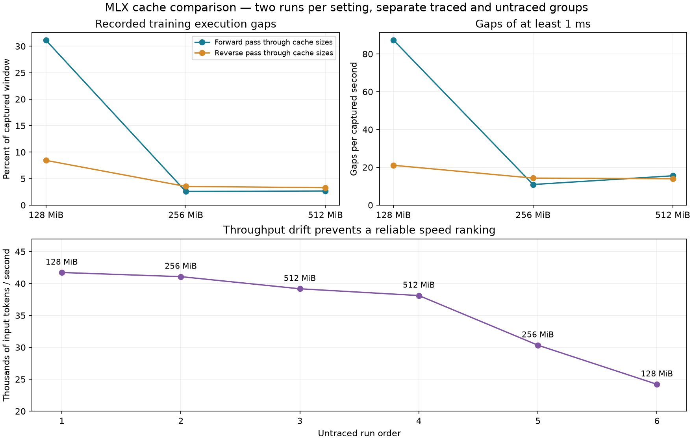

# MLX cache comparison — completed 2026-11-17

Increasing the profiling harness's cache from 128 to 256 MiB reduced recorded
training GPU execution gaps in both trace passes. 512 MiB gave no clear additional
gap reduction. Untraced throughput drifted enough that this experiment does not
establish a training-speed improvement or a reliable speed ranking.

**Recommendation:** use 256 MiB as the next diagnostic cache setting for this
workload. No production defaults were changed. The original 128 MiB cap is imposed
by the profiling harness; this is not evidence that normal training uses that cap.

## Execution gaps

Two short warmed captures per cache, in order 128,256,512,512,256,128 MiB.
Percentages mean the fraction of the selected window without a recorded training
GPU execution interval, not shader occupancy or proven whole-GPU idle time.

| Cache | Gap percentage, forward / reverse | Gaps >=1 ms per second, forward / reverse | Largest gap, forward / reverse |
|---|---:|---:|---:|
| 128 MiB | 31.11% / 8.45% | 87.35 / 21.09 | 31.80 / 4.78 ms |
| 256 MiB | 2.59% / 3.53% | 10.92 / 14.31 | 3.31 / 4.99 ms |
| 512 MiB | 2.67% / 3.30% | 15.53 / 13.97 | 3.42 / 3.60 ms |

There were 40 gaps >=5 ms in the first 128 MiB capture; none occurred in the
other five captures. Consequently, eliminating >5 ms gaps alone cannot be
credited to the cache change: the second 128 MiB capture also had none.
The more consistent cache association is lower total gap fraction and fewer
>=1 ms gaps per second at both larger settings.

Pooled gap fractions, weighted by each trace's actual window duration, were
21.11%, 3.06% and 2.98%. The total captured windows per setting were 5.371,
4.756 and 4.810 seconds, respectively. These pooled numbers do not remove
time-varying interference; individual results above are the primary evidence.



## CPU correlation

Residency-update stacks comprised 65.6% / 59.6% of symbolized main-thread
samples at 128 MiB, 39.5% / 48.8% at 256 MiB, and 40.9% / 41.8% at 512 MiB.
These are fractions of point samples, not CPU-time percentages or exact counts
of allocation/residency API calls. This supports the earlier diagnosis of buffer
management interfering with submission, while leaving its precise causal share
unmeasured. Other GPU work and tracing overhead remain confounders.

## Untraced throughput and memory

Separate fresh processes ran without Instruments, with the same reversed order.
Each ran 64 updates; rates exclude the first 16 completed updates.

| Run order | Cache MiB | Warmed input tokens/s | Peak MLX allocation MiB |
|---|---:|---:|---:|
| 1 | 128 | 41,726 | 1,766 |
| 2 | 256 | 41,078 | 1,878 |
| 3 | 512 | 39,176 | 1,882 |
| 4 | 512 | 38,117 | 1,882 |
| 5 | 256 | 30,340 | 1,828 |
| 6 | 128 | 24,216 | 1,904 |

The 128 MiB repeat declined 42.0% and the 256 MiB repeat declined 26.1%.
The rates initially favor 128 MiB and later favor 512 MiB; pooling them into a
single ranking would conceal that drift. No explanation of the throughput drift
was established. A spot `pmset -g therm` query reported no recorded thermal or
performance warning, which does not establish stable GPU clocks throughout.

Mean sampled retained cache was approximately 130, 258 and 514 MiB for the
three settings. Larger cache limits retain more memory. Peak allocation is not
monotonic because allocation timing and reuse also vary. Memory policy limits
are advisory, so sampled cache can slightly exceed the nominal limit.

The gap reduction is therefore a useful diagnostic result, not proof of an
unprofiled speedup. Profiling may amplify allocator/driver costs disproportionately
at the smallest cache setting.

## Workload, controls and acceptance

- Frozen source `/private/tmp/telos-fusion-frozen-f558146`, commit
  `f5581469adba661eee8e06d534de563ae7b0a2ae`; MLX 0.32.2, Apple M5 Pro,
  24 GiB unified memory. Source and data hashes are in `manifest.json`.
- Same 50M AR model, corpus prefix, seed 42, BF16 weights/FP32 master weights,
  MBS8 / accumulation8 / sequence256, 16,384 input tokens per update.
  Packed SwiGLU, forced fused attention and compiled accumulation on;
  experimental QKV/RoPE off, default command-buffer settings.
- Two untraced runs and two traced runs per setting, fresh processes, reversed
  order. Traced runs used 96 updates with capture requested after 20 completed
  updates, separate from the 64-update throughput group. LR schedules are
  identical within each group, not asserted identical across different lengths.
- Successful lightweight Time Profiler + GPU + Metal Application combination;
  requested two-second traces. Actual first-to-last process GPU event windows
  were 2.36–3.00 seconds. Shader Timeline and hardware counters were disabled.
- All 12 workers and six traces completed successfully. Total training:
  960 updates, 15,728,640 input tokens. No memory guard fired in this completed
  experiment. Each requested cache override was verified in worker logs.
- All trials had the same initial-weight hash. Final saved model files were
  byte-identical across all six cache runs within each run-length group:
  one unique hash for the six 64-update runs, one for the six 96-update runs.
  This validates the saved weights for these runs, not optimizer-state parity,
  long-run convergence, or universal bitwise reproducibility.
- System memory headroom was substantially better after the user freed memory.
  Whole-system GPU activity from other apps remained present and variable.
  Neither the recorded trace fraction nor system utilization establishes GPU
  occupancy, bandwidth saturation or matrix-unit efficiency.

An analysis-only plotting error interrupted the driver after the second 256 MiB
trace: the largest gap's next GPU event lacked an exported submission row.
The parser already preserved that gap in metrics; the detail plot incorrectly
assumed every gap was matched. The plot now selects a matched example and the
comparison resumed from saved artifacts. No training run was repeated or
discarded for that error. `resume_manifest.json` records revised analysis/driver
hashes and verifies unchanged frozen source, corpus and capture-worker code.

The previous failed baseline attempts on November 16 remain separately preserved
and excluded; see `reports/mlx_cache_comparison_2026-11-16.md`.

## Artifacts and reproduction

Root: `logs/mlx_cache_comparison_20261117_01/`.

- `results.json`: all 12 per-run results, including CPU/gap summaries.
- `aggregate.json`: pooled and individual cache summaries.
- `verification.json`: applied-cache checks and final model hashes.
- `manifest.json`, `resume_manifest.json`, `power.txt`: source/data/harness
  provenance and configured power policies. The power file records configuration,
  not proof of the power source or clocks for every instant of the experiment.
- Each traced directory retains raw `.trace`, GPU/encoding/submission/CPU XML,
  gap CSV, JSON analysis, timeline and correlation figures.

```sh
.venv/bin/python scripts/compare_mlx_cache.py \
  --source /private/tmp/telos-fusion-frozen-f558146 \
  --data /Users/ivansamuel/Documents/Projects/telos-mlx-fusion/reports/mlx_fusion_2026-11-16/corpus_prefix.bin \
  --output logs/mlx_cache_comparison_fresh
```

Use a fresh output directory and do not overlap another training comparison.
The source is a temporary snapshot and should be archived for long-term
reproduction. The cache override applies only to the diagnostic worker.

Underlying mechanism reference: MLX's
[v0.32.2 Metal allocator](https://github.com/ml-explore/mlx/blob/v0.32.2/mlx/backend/metal/allocator.cpp)
tries buffer reuse before creating buffers and registering non-heap allocations
in residency sets. The measurements above are local evidence; the source explains
why increasing reusable-buffer cache is a plausible intervention.

Portable summaries and figures are preserved in `reports/mlx_performance_2026-11-17/`. Raw local traces and checkpoint tensors are not included in that bundle.
