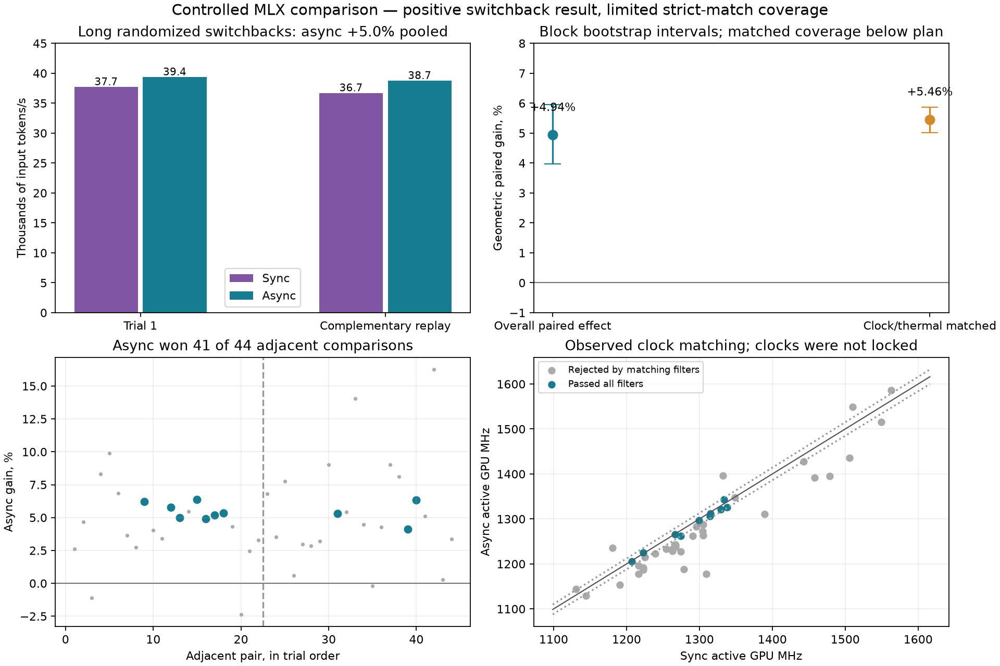

# MLX async accumulation: randomized clock/thermal follow-up — 2026-11-17

Async was faster in this follow-up: **37,191 input tok/s synchronous versus
39,047 async (+4.99%)**, winning 41 of 44 adjacent comparisons. The previous
separate-process result of −3.97% does not establish a consistent async penalty.
However, clocks were observed and matched, not physically locked. The strict
matched subset missed its planned coverage gate, so this is not sufficient to
promote always-on async automatically. Async remains opt-in; version stays 1.7.5
pending the v1.7.6 decision.

## Completed experiment

Two fresh training workers each completed 1,536 optimizer updates, with 128 warmup
updates excluded. Each worker lasted about eleven minutes. Total work was 3,072
updates and 50,331,648 input tokens, matching the prior comparison's total work.
Within each worker, 32-update synchronous and async blocks formed 24 adjacent
pairs. Twelve pairs led with each mode, randomly ordered using seed 20261117.
The second worker complemented every assignment and replayed the same initial
model seed and data positions. Removing two warmup pairs left 22 pairs per trial.
Schedule randomization uses a separate host RNG from training.

| Replay | Sync input tok/s | Async input tok/s | Pooled rate gain | Strict matched pairs | Peak MLX MiB |
|---|---:|---:|---:|---:|---:|
| First | 37,705 | 39,356 | +4.38% | 7 | 2,353 |
| Complementary | 36,692 | 38,742 | +5.59% | 3 | 2,351 |
| Combined | 37,191 | 39,047 | +4.99% | 10 | — |

Rates divide completed warmed input tokens by completed update time. Including
the gaps between updates within each block gives similar trial gains, +4.30%
and +5.73%. Final full-state saves are outside timing.



The geometric paired gain across all 44 pairs was +4.94%, with a paired bootstrap
95% interval of +3.97% to +5.96%. Intervals resample adjacent pairs (10,000 draws,
seed 20261117); they do not quantify independent-machine or independent-long-run
uncertainty, and serial dependence may make them optimistic.

## Controls and strict matching

AC power and the existing high-power policy were retained. Before each worker,
we required 30 continuous seconds of nominal thermal state and estimated GPU
power at or below 1 W, with memory/swap headroom. Continuous monitoring guarded
against AC loss and serious/critical thermal states. Normal desktop activity
continued, including Screen Sharing. No GPU clock-lock facility was available
through this setup; fan and power settings were unchanged.

An earlier preflight required low external CPU activity and never started a timed
trial because Screen Sharing exceeded that threshold. It was aborted, preserved
under `logs/mlx_clock_switchback_20261117_01`, and the protocol revised before any
timed comparison: record external CPU load and match it between adjacent blocks.
Valid runs are under `logs/mlx_clock_switchback_20261117_02`.

IOReport sampling windows have explicit start/end epochs. A block only uses
intervals fully contained within it. Strict pair acceptance requires:

- At least six complete hardware intervals per block, all mapped to GPU clocks.
- Within-block frequency coefficient of variation at most 2%.
- Adjacent block mean active frequencies within 1%.
- The same single nominal or fair thermal label in both blocks, and AC power.
- Median highest external non-Python process CPU estimates within 15 percentage points.

The plan required at least eight accepted pairs in each trial and sixteen total.
Actual coverage was **7 and 3, ten total: the gate failed**. Thresholds were not
relaxed. All ten accepted pairs favored async, with geometric gain +5.46%
(bootstrap interval +5.02% to +5.87%), but this conditional subset is exploratory.
Active P-state distributions still differed: accepted-pair total-variation
distances ranged from 0.015 to 0.123 despite close mean clocks.

GPU residency is system-wide, not process-specific. Thermal labels are coarse,
not chip-temperature measurements. GPU energy is an IOReport estimate. CPU energy
counters were unavailable (reported zero); they do not establish zero CPU power.
Matching a clock that may itself respond to async is not a locked-clock causal
intervention. The randomized overall result estimates switching modes in a
roughly 50%-async workload. It cannot establish the thermal/governor behavior of
running 100% async continuously, across other shapes, or on other machines.

## Numerical identity and memory finding

Both final models and all saved optimizer/master-weight/MLX-RNG arrays were
byte-identical across the complementary replays:

- Model SHA-256: `2014f36acbd031c84a1d6856deb6554cbbbc6df53eac3c0736b70002b590fe5e`.
- Array-state SHA-256: `e53df52fbfd2de770d4011aaa232b7bd2b99e0b936b7b3b71e39aa745857e019`.

This checks the saved array state, not arbitrary Python state, host RNGs or dataset
cursor resume equivalence. The earlier two-by-sixteen-update switching pilot also
preserved exact array state and verified schedule labels.

Both trials showed a shared retained allocation increase immediately after the
checkpoint at update 1,000: active allocation went from about 469 to 938 MiB.
Last-third minus first-third active growth was 479/488 MiB; retained-cache growth
was −0.18/+0.01 MiB. This is not evidence of an async queue leak. A separate
reproducer showed the recursive checkpoint encoder retained a 4 MiB tensor until
cyclic garbage collection: 4,194,349 bytes before collection, zero after.

The encoder closure captured its array accumulator through a recursive closure
cycle. Commit `51741b0` passes the accumulator explicitly, releasing tensors
without waiting for cyclic GC and preserving the serialized format. A regression
test checks release with GC disabled and exact nested-state round-trip. The long
workers used the old frozen serializer; the later fix has unit/full-suite
validation, not a new sustained performance result. Excluding the pair containing
the checkpoint, pre-checkpoint and post-checkpoint geometric async gains were
+4.87% (26 pairs) and +5.07% (16 pairs).

## Provenance, artifacts and validation

The workload was the frozen 50M AR, BF16/FP32-master configuration at context 256,
microbatch 8, accumulation 8, compiled accumulation, forced attention, packed
SwiGLU, QKV/RoPE off and 256 MiB cache. Source was
`/private/tmp/telos-mlx-async-followup-20261117`, derived from the previously frozen
`telos-fusion-frozen-f558146` runtime with the async step/core changes. This avoids
changing the workload against the prior comparison, but differs from current
main's memory planner and does not benchmark the later checkpoint fix.

Portable evidence:

- [Frozen source/data/harness hashes](mlx_performance_2026-11-17/clock-switchback-manifest.json).
- [Protocol and matching thresholds](mlx_performance_2026-11-17/clock-switchback-plan.json).
- [Complete block and pair analysis](mlx_performance_2026-11-17/clock-switchback-analysis.json).
- [Hardware windows](mlx_performance_2026-11-17/clock-hardware.csv) and [cooldown samples](mlx_performance_2026-11-17/clock-cooldown.csv).
- [Analysis code hashes](mlx_performance_2026-11-17/clock-analysis-manifest.json) and [singleton-interval correction](mlx_performance_2026-11-17/clock-analysis-revisions.json); matching criteria unchanged.
- [Checkpoint sensitivity and retention reproducer](mlx_performance_2026-11-17/checkpoint-retention-analysis.json).

The portable bundle excludes raw model/state binaries, environment dumps and
process snapshots. Raw local logs retain schedules and invocation records. The
analyzer can be rerun with:

```sh
.venv/bin/python scripts/analyze_mlx_switchback.py logs/mlx_clock_switchback_20261117_02
```

The orchestrator is `scripts/compare_mlx_switchback.py` (requires explicit
`--source`, `--data`, and a new `--output` directory). Five analysis tests cover
schedule balance/RNG isolation, interval containment, rejection rules, paired
bootstrap and omission of a singleton confidence interval. After the checkpoint
fix, the full suite completed with **398 passed, 7 skipped**.
