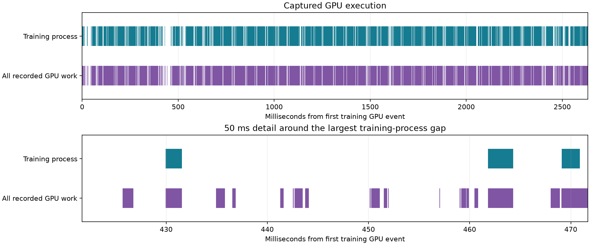

# MLX execution timeline — 2026-11-16

A short warmed Metal trace records millisecond-scale interruptions in training
GPU execution. These are execution-envelope observations, not shader occupancy
or a complete hardware-utilization measurement. No trainer changes were made.

## Recorded result

Source: `logs/mlx_timeline_20261116_02/analysis.json`, with raw trace and XML exports
in the same directory. Attached training PID 81393; Apple M5 Pro, MLX 0.32.2.

| Recorded measure | Training process | All recorded GPU work |
|---|---:|---:|
| Union of active execution intervals / selected window | 80.93% | 85.49% |
| Total uncovered time | 502.35 ms | 382.27 ms |
| Gaps >=1 ms | 151 | 112 |
| Gaps >=5 ms | 9 | 4 |
| Gaps >=10 ms | 5 | 0 |
| Largest gap | 30.26 ms | 6.71 ms |

The selected window is 2.633736584 seconds, from the first to last GPU
execution event attributed to training, trace times 0.505402916–3.139139500 s.
It overlaps optimizer updates 26–32, including partial steps at the edges.
There are 1,428 training execution events and 22,300 events across processes.
Intervals are clipped to that window and merged across overlapping channels
before calculating gaps; durations are not simply summed.

WindowServer, Browser Helper, Codex, Antigravity and Screen Sharing appear among
the other GPU users. Therefore a gap in training execution does not establish
that the entire GPU was idle. Even all-process gaps mean absence of recorded
execution, not proof that every hardware subsystem was inactive. The union
percentages above must not be presented as corrected occupancy percentages.



## Capture and validation

The frozen source `/private/tmp/telos-fusion-frozen-f558146` uses commit
`f5581469adba661eee8e06d534de563ae7b0a2ae`. Configuration: 50M AR, BF16 with
FP32 master weights, MBS8 / accumulation8 / sequence256, packed SwiGLU,
forced fused attention and compiled accumulation enabled; QKV/RoPE experiment
off and default command-buffer settings. Data is the same corpus prefix used
by the contemporaneous comparison. Its metadata records the initial-weight hash.

The worker completed 128 updates / 2,097,152 input tokens in approximately
60 seconds. That duration includes profiling interference and is not a new
throughput benchmark. The original comparison was inspected without attaching
Instruments; it independently stopped during its fourth trial with a swap-growth
guard, before this diagnostic worker was launched.

The successful capture used Time Profiler with high-frequency sampling, waiting
thread sampling and context-switch sampling, plus GPU and Metal Application
instruments. It attached after 20 updates, requested two seconds, and reported
a 3.139523-second run duration. Actual GPU execution coverage was checked from
the exported rows, rather than assuming the requested duration was the coverage.
Shader Timeline and hardware counters were disabled in this lighter capture.
The trace retains CPU samples for attribution; the follow-up correlation below
identifies buffer allocation/residency management during the largest gaps.

An earlier capture using the existing `Telos MLX GPU Profile` template failed
inside Instruments' Metal residency modeler, and its worker stopped on a memory
guard. It is excluded from these measurements. The invalid bundle is retained
under `logs/mlx_timeline_20261116_01/metal.trace` for diagnosis, not analysis.
No further heavy counter capture was attempted.

New scripts:

- `scripts/capture_mlx_timeline.py`: separate frozen-source worker, nanosecond
  host timestamps and process CPU-time deltas per step, warmed trace attachment,
  one-second system observation, memory guards, bounded capture, and compact XML exports.
- `scripts/analyze_mlx_timeline.py`: process attribution, interval union, gap CSV,
  step overlap, JSON summary and timeline figure. No per-step synchronization is
  added by the wrapper; the frozen accumulation path already evaluates updates.

The successful worker and trace exited with status zero; the table-of-contents
and both interval exports succeeded. Interval union, clipping and gap arithmetic
were checked against an overlapping synthetic example. The generated figure was
visually inspected. Source trainer, model, defaults and existing edits were preserved.

## Reproduce

Run only when another training comparison is not active. The source directory
is a temporary frozen snapshot; archive it before relying on this command later.
Choose a fresh output directory.

```sh
.venv/bin/python scripts/capture_mlx_timeline.py \
  --source /private/tmp/telos-fusion-frozen-f558146 \
  --data /Users/ivansamuel/Documents/Projects/telos-mlx-fusion/reports/mlx_fusion_2026-11-16/corpus_prefix.bin \
  --output logs/mlx_timeline_fresh --updates 128 --warmup 20 --seconds 2
.venv/bin/python scripts/analyze_mlx_timeline.py logs/mlx_timeline_fresh
```

The default is the lighter successful instrument combination. Full counter and
shader captures require a separate configuration and substantially more memory.
The current scripts target this frozen pretraining harness, not CUDA or all
training objectives. Capture output includes machine/process metadata and should
be reviewed before sharing.

## Interpretation and next measurement

The observed gaps justify testing CPU/GPU scheduling as a hypothesis. They do
not establish a removable 19% overhead: unrelated GPU work, memory pressure,
capture perturbation, command dependencies and recording completeness all matter.
Correlate the largest gaps with captured CPU samples and encoding intervals,
then repeat isolated short windows under better memory headroom. Shader occupancy,
bandwidth limits and matrix-unit efficiency remain unmeasured here.

## CPU and command-buffer correlation

Follow-up used only the saved successful trace; no new training workload or
attachment was started. A separate comparison had resumed by the time of this
analysis, and its processes were left alone. Additional exports are
`cpu_samples.xml` and `submissions.xml`. Reproduction:

```sh
/Applications/Xcode.app/Contents/Developer/usr/bin/xctrace export \
  --input logs/mlx_timeline_20261116_02/metal.trace \
  --xpath '/trace-toc/run[@number="1"]/data/table[@schema="time-profile"]' \
  --output logs/mlx_timeline_20261116_02/cpu_samples.xml
/Applications/Xcode.app/Contents/Developer/usr/bin/xctrace export \
  --input logs/mlx_timeline_20261116_02/metal.trace \
  --xpath '/trace-toc/run[@number="1"]/data/table[@schema="metal-application-command-buffer-submissions"]' \
  --output logs/mlx_timeline_20261116_02/submissions.xml
.venv/bin/python scripts/correlate_mlx_timeline.py logs/mlx_timeline_20261116_02
```

### Finding: host buffer management delays submission in this capture

All 151 gaps of at least 1 ms match the subsequent GPU execution's command-buffer
ID to a recorded submission interval. In all 151, that interval ended after the
gap began. The subsequent buffer's preparation interval overlaps 91.64% of the
combined duration of these gaps. Median time from preparation/submission interval
end to GPU execution is 0.146834 ms. For every one of these joins, the calculated
delta agrees exactly with the independent CPU-to-GPU latency field in the GPU
execution table. That validates the ID joins and clock alignment; it does not
prove the preparation interval was continuously executing CPU instructions.

The nine gaps of at least 5 ms all contain main-thread stack samples inside
Metal buffer allocation, resource creation, or residency maintenance. Examples:

| GPU gap | Update(s) | Same next buffer's preparation overlap | Preparation end to GPU | CPU samples during gap |
|---|---|---:|---:|---|
| 30.264 ms | 27 | 30.127 ms | 0.137 ms | Kernel encoding, residency updates, buffer creation |
| 17.811 ms | 26 | 17.670 ms | 0.141 ms | Three residency-update samples, allocating for custom kernels/GEMM/concatenation |
| 11.805 ms | 27 | 11.646 ms | 0.159 ms | Two residency-update samples |
| 11.070 ms | 27 | 10.915 ms | 0.155 ms | Residency update and driver resource-list lock wait |
| 10.636 ms | 26 | 9.977 ms | 0.659 ms | Residency updates during custom-kernel and GEMM allocation |

The largest gap occurs wholly inside update 27. Only six of the 151 >=1 ms
gaps cross a host optimizer-step boundary. This argues against logging or input
preparation between optimizer steps as the general explanation of the long gaps.
It does not identify every microbatch boundary; those were not individually marked.

The characteristic observed stack is:

```text
iokit_user_client_trap
IOGPUResourceGroupUpdateResources
AGXG17XFamilyResidencySet _commitAddedAllocations...
IOGPUMetalResidencySet commit
mlx::core::metal::ResidencySets::insert
mlx::core::metal::MetalAllocator::malloc
Matmul::eval_gpu / fast::CustomKernel::eval_gpu / copy_gpu
gpu::eval -> eval_impl -> eval
```

In plain terms, MLX is getting memory buffers ready and registering them with
the GPU driver while the previously submitted training work has already run out.
The GPU resumes shortly after the next buffer is ready. This is the strongest
supported explanation of the largest training gaps in the captured execution.
It places the observed path in native MLX/Metal resource handling rather than
ordinary Python interpreter work. A Rust wrapper using the same allocator would
still encounter that path.

### CPU sampling and secondary evidence

There are 468 main-thread samples with symbolized backtraces inside the selected
GPU window. Of those, 301 include residency updates, 34 Metal resource creation,
29 other Metal allocator/allocator-lock work, and 37 MLX completion waits.
These are mutually exclusive categories selected from stack symbols, not
percentages of wall time. Residency work also occurs while the GPU is active;
its presence alone does not prove a stall.

There are 122 main-thread stack samples inside training gaps: 59 residency,
5 buffer creation, 6 other allocation/allocator lock, 37 completion waits,
and 15 other native categories. All 37 sampled MLX completion waits occur in
recorded training gaps. Only 71 of the 151 >=1 ms gaps contain a main-thread
backtrace sample, so this capture cannot assign a stack to every gap.
Despite the requested high-frequency setting, ordinary backtrace points are
often around 5 ms apart; context-switch rows are additional observations and
cannot be mistaken for independent symbolized stacks at submillisecond cadence.
The profiler's `Running` label on a kernel-trap sample does not prove it was
executing user instructions throughout the surrounding interval.

Other GPU work occupies 5.406 ms of the 30.264 ms largest training gap.
Other applications can contribute interference, but do not fill or explain
the entire recorded absence of training execution in that window.

### Mechanism and next controlled test

The frozen harness explicitly sets `mx.set_cache_limit(128 * 1024**2)`.
MLX's [v0.32.2 allocator source](https://github.com/ml-explore/mlx/blob/v0.32.2/mlx/backend/metal/allocator.cpp)
first tries reusable cached buffers; cache misses allocate a buffer and insert
non-heap buffers into residency sets. Its
[residency source](https://github.com/ml-explore/mlx/blob/v0.32.2/mlx/backend/metal/resident.cpp)
commits the affected residency set on insertion. This is consistent with the
sampled stack sequence. The source tag is supporting mechanism evidence, not
proof that every detail of the installed binary matches that checkout.

The leading testable hypothesis is repeated buffer creation/residency churn,
potentially amplified by the small cache, system memory pressure and capture
overhead. A guarded, same-workload 128 vs 256/512 MiB cache comparison should
measure new buffer creation, residency calls, long gaps, completed-work throughput
and total retained memory. Larger cache limits can retain more memory; a speed
gain is not established and must not be assumed. Do this separately from the
currently active comparison and with adequate system memory headroom.

Microbatch completion barriers are a secondary candidate: the source evaluates
accumulated gradients between microbatches, and completion waits appear in gaps.
Bounded asynchronous accumulation may reduce scheduling bubbles but does not
directly fix buffer allocation/residency cost. The immediate evidence prioritizes
allocation reuse and residency handling before a host-language rewrite.

Outputs: `correlation.json`, `correlated_gaps.csv`, and `correlation.png` in the
capture directory, plus reusable `scripts/correlate_mlx_timeline.py`. Checks
confirmed overlap bounds, category totals, and every >=1 ms buffer/latency join.
The figure was visually inspected. No numerical training code or defaults changed.

This identifies the path delaying submissions in this trace. It does not yet
measure the removable overhead in an unprofiled, low-pressure run or establish
that cache size alone causes it. Full shader occupancy and bandwidth remain open.

Apple describes GPU execution tracks, CPU analysis and CPU/GPU overlap in
[Analyzing the performance of your Metal app](https://developer.apple.com/documentation/xcode/analyzing-the-performance-of-your-metal-app/),
and distinguishes occupancy as thread-capacity usage in
[Finding your Metal app's GPU occupancy](https://developer.apple.com/documentation/xcode/finding-your-metal-apps-gpu-occupancy).

Portable summaries and figures are preserved in `reports/mlx_performance_2026-11-17/`. Raw local traces and checkpoint tensors are not included in that bundle.
