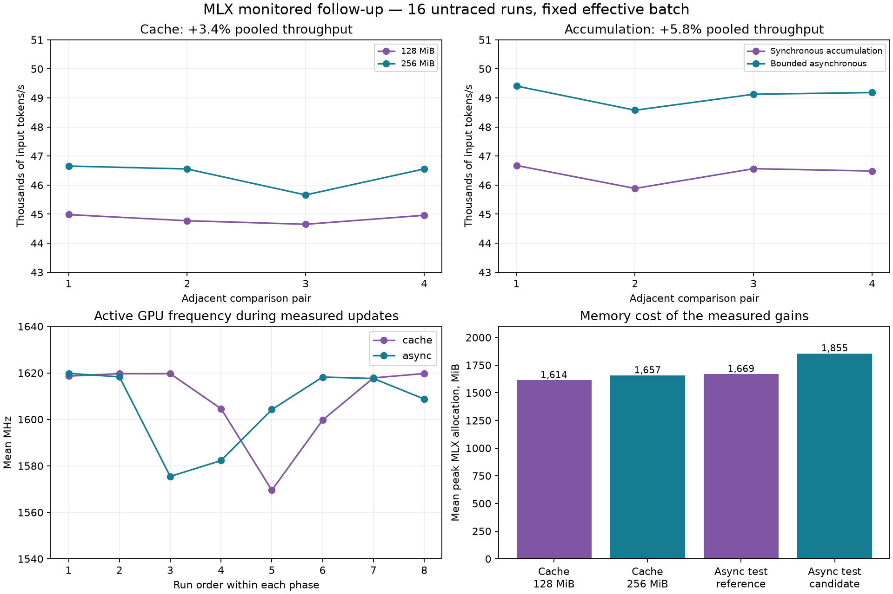

# Monitored MLX cache and accumulation follow-up — 2026-11-17

Two interleaved eight-run experiments found repeatable, modest throughput gains
on the frozen 50M AR workload: **+3.37% for 256 versus 128 MiB cache**, then
**+5.76% for bounded asynchronous accumulation at fixed 256 MiB cache**.
All 16 final model files were byte-identical. The profiling harness now defaults
to 256 MiB; asynchronous accumulation is available as an experimental opt-in.

The earlier 42% throughput decline did not recur. Its historical cause remains
unresolved because the old experiment did not record the necessary clock/power
telemetry. These new measurements do not retroactively establish its cause.



## 1. Drift investigation and telemetry

`powermetrics` required an administrator password, so it was not used. A new
read-only, non-root IOReport monitor records GPU performance-state residency,
active frequency mapped from the machine's pmgr table, raw energy counters and
GPU power estimates. Foundation supplies thermal state; `ps` captures competing
process names/CPU estimates/RSS and `pmset` samples the power source. No external
app was closed or modified by the runner and no global monitoring package was
installed. A release-binary download was unavailable; no downloaded executable
was used. The implemented FFI reader uses the system IOReport library directly.

The monitor retains raw states and frequency-table coverage, rather than assigning
a frequency when nonzero residency occurs outside the known table. Every warmed
frequency sample in these experiments mapped successfully.

| Observation | Cache experiment | Accumulation experiment |
|---|---:|---:|
| Per-run mean active GPU frequency | 1,569.5–1,619.7 MHz | 1,575.4–1,619.8 MHz |
| Individual warmed frequency samples | 1,558.7–1,620 MHz | 1,548.0–1,620 MHz |
| Per-run mean estimated system GPU power | 27.38–31.19 W | 29.40–32.61 W |
| Thermal sample counts | 129 nominal | 56 nominal, 68 fair |
| Sampled power source | All observed samples AC | All observed samples AC |

No serious or critical thermal state was sampled. The lowest-clock cache run
also had somewhat lower throughput, and one lower-clock asynchronous pair ran
slower than the others, but the candidate still won each adjacent comparison.
These correlations do not assign all residual variation to clocks. CPU energy
counters returned zero throughout: CPU power is **unavailable**, not established
as physically zero. GPU energy/power values are estimates for the whole GPU,
not measurements attributable exclusively to training. `ps` CPU percentages are
OS estimates, not exact CPU-time intervals aligned to each GPU gap.

The former collapse from 41.7k to 24.2k tokens/s is absent here. The monitored
128 MiB runs ranged only 44.65–44.98k tokens/s. Competing-process snapshots and
raw hardware counters are retained in every run's `hardware.jsonl`. The data
support improved measurement stability, not a proven explanation of the old decline.

## 2. Interleaved 128 / 256 MiB retest

Order: 128,256,256,128,256,128,128,256 MiB. Each fresh process completed
64 updates with 16 warmup updates excluded. Rates measure completed update work.

| Adjacent pair | 128 MiB tok/s | 256 MiB tok/s | Gain |
|---|---:|---:|---:|
| 1 | 44,983 | 46,655 | 3.72% |
| 2, reverse order | 44,773 | 46,554 | 3.98% |
| 3, reverse order | 44,651 | 45,661 | 2.26% |
| 4 | 44,961 | 46,558 | 3.55% |
| Pooled completed-work rate | 44,842 | 46,353 | **3.37%** |

Mean peak MLX allocation was 1,614.0 versus 1,656.9 MiB (+42.8 MiB).
This is four positive short-run comparisons under substantially more stable
conditions, not a universal gain or a multi-hour thermal benchmark.

## 3. Profiling harness policy

`scripts/profile_mlx_training.py` now accepts `--cache-mib` and defaults to 256.
The timeline wrapper's default is also 256; explicit historical comparisons
continue passing their chosen cache limit. A nonpositive cache size is rejected.
This changes diagnostic harness behavior, not normal training's global memory
policy. The 128 MiB baseline cap was introduced by the old profiling script;
it must not be described as an established production default bottleneck.

The policy was changed only after all four cache comparisons showed a gain.

## 4. Bounded asynchronous accumulation

The new `async_accumulation` setting defaults to false. At microbatch boundaries,
the candidate submits the next accumulated-gradient evaluation with `mx.async_eval`
before waiting for the previous evaluation. It snapshots immutable array handles
and holds at most two submitted microbatch evaluations at a time. It retains the
same left-to-right gradient additions and completes the optimizer update before
returning. It uses one host thread; no concurrent Python MLX execution is introduced.

The eager memory policy and synchronized stage profiler retain their existing
boundaries. Accumulation=1 keeps its existing full-step behavior. The pipeline
only applies if accumulation remains greater than one after memory planning.

At fixed 256 MiB cache, order was reference,candidate,candidate,reference,
candidate,reference,reference,candidate, again 64 updates / 16 excluded warmups.

| Adjacent pair | Reference tok/s | Candidate tok/s | Gain |
|---|---:|---:|---:|
| 1 | 46,674 | 49,409 | 5.86% |
| 2, reverse order | 45,885 | 48,577 | 5.87% |
| 3, reverse order | 46,565 | 49,127 | 5.50% |
| 4 | 46,484 | 49,185 | 5.81% |
| Pooled completed-work rate | 46,400 | 49,073 | **5.76%** |

Mean peak MLX allocation rose from 1,668.8 to 1,855.1 MiB (+186.3 MiB).
The memory guard settings were unchanged. No guard fired in either completed
experiment. Do not compound the two percentages into a universally expected gain:
they come from separate fixed-workload cohorts.

Enable explicitly in the normal training CLI with `--async-accumulation`, in
programmatic `train(..., async_accumulation=True)`, or YAML:

```yaml
training:
  async_accumulation: true
```

The profiling CLI also accepts `--async-accumulation`. It remains experimental:
only this full-model workload has a throughput measurement, and the memory
tradeoff may be unsuitable for another model, context length or RAM tier.
No SFT/DPO, CUDA, TPU or distributed result is claimed.

## Validation

All 16 benchmark workers completed: 1,024 updates / 16,777,216 input tokens.
All 16 final saved BF16 model files had one unique SHA-256 hash, including both
cache limits and both accumulation paths. Model equality does not by itself
establish full optimizer-state equality or long-run convergence.

The focused Metal tests additionally compare losses, explicitly clipped
accumulated gradients, optimizer moments, model/master weights, changing learning
rates and subsequent RNG samples. They cover accumulation 2/8, compiled and
uncompiled accumulation, FP32 and BF16/master paths, eager fallback, and a
dispatch observer checking that the host queue never exceeds two submitted
microbatch evaluations before a previous one is waited on.

```sh
.venv/bin/python -m pytest -q \
  tests/test_mlx_async_accumulation.py tests/test_mlx_step.py \
  tests/test_mlx_compiled_accumulation.py
```

Result: **23 passed**. Focused numerical checks use stated tolerances; the full
model's byte equality is an additional observation specific to these runs.

A current-source CLI smoke test completed two updates with the new option
recorded as true and actual memory plan BS2/accum2. A first attempted 0.5 GiB
cap was invalid under the existing minimum-headroom policy; a normal-cap retry
collapsed to accumulation=1 under the existing planner. The final smoke test
used a 1.03125 GiB ceiling for the tiny 577,728-parameter model, preserving the
required 1 GiB headroom and forcing BS2/accum2. It succeeded without changing the
memory planner. The successful artifact is `logs/mlx_followup_cli_smoke_20261117_03/`.

CLI help, Python compilation and `git diff --check` also passed. The measurements preceded the follow-up commits; no release or production
deployment was performed by this experiment.

## Provenance and reproduction

Cache tests use `/private/tmp/telos-fusion-frozen-f558146`. Accumulation tests
use `/private/tmp/telos-mlx-async-followup-20261117`, copied from the same frozen
snapshot with only the new core/step implementation substituted. Both phases
preserve the 50M causal AR model, BF16/FP32-master precision, seed 42, corpus
prefix, MBS8 / accumulation8 / sequence256, packed SwiGLU, forced fused attention,
compiled accumulation and default command-buffer limits. Experimental QKV/RoPE
is off. Each update has 16,384 input tokens. Source/data/harness hashes are in
each experiment's manifest, avoiding reliance on the evolving main checkout.

The latest main checkout may select a different microbatch plan. These numbers
describe the frozen workload above; the current-source smoke test validates
configuration wiring, not current main's 50M throughput.

Artifacts:

- `logs/mlx_followup_cache_20261117_01/`: eight cache trials and hardware logs.
- `logs/mlx_followup_async_20261117_01/`: eight accumulation trials and hardware logs.
- `logs/mlx_followup_summary_20261117.json`: derived per-run and pooled metrics.
- Each phase's `final_weight_hashes.json`: saved-model verification.
- `scripts/run_mlx_followup.py`: interleaved comparison runner.
- `scripts/mlx_hardware_monitor.py`: non-root telemetry reader.

```sh
.venv/bin/python scripts/run_mlx_followup.py \
  --source /private/tmp/telos-fusion-frozen-f558146 \
  --data /Users/ivansamuel/Documents/Projects/telos-mlx-fusion/reports/mlx_fusion_2026-11-16/corpus_prefix.bin \
  --output logs/mlx_followup_cache_fresh --mode cache
.venv/bin/python scripts/run_mlx_followup.py \
  --source /private/tmp/telos-mlx-async-followup-20261117 \
  --data /Users/ivansamuel/Documents/Projects/telos-mlx-fusion/reports/mlx_fusion_2026-11-16/corpus_prefix.bin \
  --output logs/mlx_followup_async_fresh --mode async
```

Temporary snapshots must be archived for long-term replay. Raw telemetry uses
private Apple APIs and remains best effort. GPU frequency-table mapping and
energy-unit interpretation were checked against the primary implementation in
[macmon sources](https://github.com/vladkens/macmon/blob/main/src/sources.rs) and
[metrics](https://github.com/vladkens/macmon/blob/main/src/metrics.rs).
[MLX compilation documentation](https://ml-explore.github.io/mlx/build/html/usage/compile.html)
supports explicitly capturing RNG state; the existing compilation state contract
is retained by the pipeline.

Portable summaries and figures are preserved in `reports/mlx_performance_2026-11-17/`. Raw local traces and checkpoint tensors are not included in that bundle.
