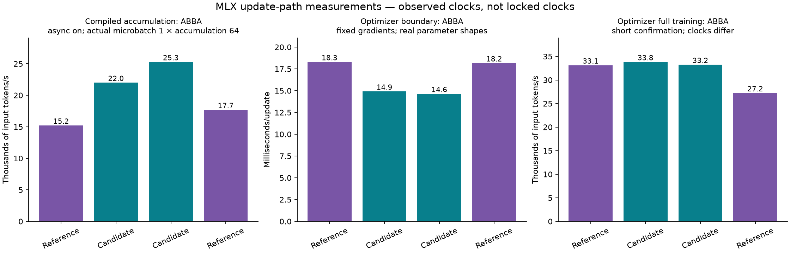

# MLX compiled accumulation, attention dispatch and optimizer work — 2026-11-18

Compiled accumulation with async enabled measured faster in both ABBA comparisons
on the current trainer under a fixed memory ceiling. The narrow accumulated
optimizer change also reduced isolated update-boundary time and preserved exact
saved arrays in short full-training replays. Attention uses the MLX API, but the
installed MLX 0.32.2 does not provide native Metal SDPA backward. The prior native
backward results used isolated MLX 0.32.4 and are not automatically active here.

The memory planner was left unchanged. No microbatch sweep was performed. The
projection/CE primitive remains last on the [optimization agenda](../docs/mlx-optimization-agenda.md),
as a potential v1.8 project. This work does not publish another release.



## Compiled accumulation with async

Four fresh processes ran compiled accumulation off/on/on/off. Each completed
192 updates, with 32 warmup updates excluded. Async accumulation was enabled in
all runs. The 50M AR model used BF16 weights, FP32 masters, context 256, real-corpus
input, 256 MiB cache and a 3.2 GiB advisory MLX ceiling. Packed SwiGLU, forced
attention and QKV/RoPE were off. This is the current trainer at `0ca4d19`, not the
older frozen benchmark runtime.

Although the diagnostic requested 8×8, the production memory planner selected
**microbatch 1 × accumulation 64, checkpointing off**, preserving effective batch
64 in every run. The ceiling and selected plan were held fixed. The result is
specific to this memory-constrained plan, not every batch shape or objective.

| Order | Compiled accumulation | Warmed input tok/s | Warmed active GPU MHz | Thermal labels | Peak MLX MiB |
|---|---|---:|---:|---|---:|
| 1 | Off | 15,214 | 1,270 | Nominal | 1,009 |
| 2 | On | 21,998 | 1,317 | Nominal | 999 |
| 3 | On | 25,284 | 1,235 | Nominal/fair | 922 |
| 4 | Off | 17,693 | 1,565 | Fair | 1,018 |

Pooled completed-update rates were **16,360 versus 23,527 input tok/s (+43.80%)**.
The forward comparison favored compiled accumulation by +44.59%; reverse favored
it by +42.90%. Compilation combines later microbatch backward work with gradient
accumulation; it remains separately selectable using `--compiled-accumulation`.
Its production default was not changed by this check.

All four initial and final model files matched respectively. All saved numerical
array leaves, including master weights, optimizer and MLX RNG, also matched
exactly. The numerical-array hash excludes the serializer's structure JSON,
which contains different paths/configuration and host scalar metadata; this is
not arbitrary Python-state or complete resume-equivalence evidence.

Clocks were observed rather than locked, and thermal labels differed. The large
consistent direction supports this option on the measured plan, but +43.80% is
an observed result, not an isolated compiler effect or a universal expected gain.
Desktop activity continued. No memory/swap guard fired; system swap remained
2,794.88 MiB at the sampled endpoints. Warmed clocks only use complete IOReport
intervals contained within the warmed training window. No MHz normalization is
presented as measured throughput.

## Attention: implemented API, version-dependent execution

`MLXTransformerBlock` calls `mx.fast.scaled_dot_product_attention` directly. Its
`force_fused_attention` option exists, but the normal default is false. The local
graph audit on installed **MLX 0.32.2** exported and evaluated four BF16 causal
training graphs: batch 1, eight equal query/KV heads, dimension 64, context 256 or
2048, each with force-fused off/on. All outputs and dQ/dK/dV were finite.

| Setting | Fused forward nodes | Native SDPA VJP nodes |
|---|---:|---:|
| Default, context 256 | 0 | 0 |
| Forced fused, context 256 | 1 | 0 |
| Default, context 2048 | 0 | 0 |
| Forced fused, context 2048 | 1 | 0 |

The [version-pinned MLX 0.32.2 Metal source](https://github.com/ml-explore/mlx/blob/v0.32.2/mlx/backend/metal/scaled_dot_product_attention.cpp)
selects fallback forward during training unless forced; its native VJP fallback
predicate returns true. This agrees with the installed graphs. The previous
[0.32.4 native/fallback study](mlx_fusion_2026-11-16/FULL_ATTENTION_VALIDATION.md)
remains relevant to an isolated runtime upgrade, not proof of the installed
path. Télos has no per-shape backward dispatcher. No runtime upgrade, environment
mutation in production, or attention default change was made here.

## Scaling, clipping and optimizer fusion

Previously, accumulated gradients were scaled/clipped outside the compiled
optimizer function. Commit `9a11710` moves that math inside the cached update,
passing clipping threshold and accumulation scale explicitly so later changes
are honored. First-update initialization and moment casting remain unchanged;
master updates still project back to BF16 model weights. Single-microbatch fused
updates already handled clipping inside their compiled function.

A boundary probe used the real 50M parameter shapes with fixed synthetic
BF16 gradients and FP32 masters. It compared old/new/new/old for 64 updates per
trial, excluding 16 warmup updates, with a 256 MiB cache. It does not execute the
model's forward/backward work.

| Order | Boundary | Warmed milliseconds/update | Peak MLX MiB |
|---|---|---:|---:|
| 1 | Old | 18.29 | 1,241 |
| 2 | New | 14.91 | 1,235 |
| 3 | New | 14.64 | 1,219 |
| 4 | Old | 18.16 | 1,241 |

Mean boundary time fell from **18.23 to 14.78 ms (18.9% less time)**. All final
model/master/optimizer arrays matched exactly across the four probe runs. A
separate stochastic tiny-model comparison over changing accumulation, clipping
and learning rate matched all 120 recorded arrays exactly. These checks do not
establish exact arithmetic across every shape.

A synchronized stage diagnostic measured optimizer work at 13.90 ms of a
738.99 ms update (1.88%). Stage profiling bypasses both async pipelining and the
compiled-accumulation hook, so this fraction is diagnostic and cannot be combined
with the boundary ratio to claim a measured whole-training speedup.

### Short full-training confirmation

Four more fresh workers ran 64 updates each, excluding 16 warmup updates. All
used async and compiled accumulation, with the same 1×64 memory plan. Their
final model and all saved numerical array states matched exactly.

| Order | Boundary | Warmed input tok/s | Active GPU MHz | Peak MLX MiB |
|---|---|---:|---:|---:|
| 1 | Old | 33,119 | 1,620 | 922 |
| 2 | New | 33,822 | 1,620 | 974 |
| 3 | New | 33,245 | 1,600 | 967 |
| 4 | Old | 27,221 | 1,363 | 1,042 |

The first pair favored the new boundary by +2.12%, with almost identical mean
clocks but differing thermal labels. The reverse pair's +22.13% and pooled
+12.21% are strongly confounded by the final reference's lower clocks. These
short runs validate integration and state identity, not a stable 12% training
speedup. The candidate's peaks were within the reference range; final active
allocation was about 468.90 MiB in every run. Peak-memory improvement is not
established. No memory guard fired.

## Validation and reproduction

The isolated candidate passed **401 tests, 7 skipped** on MLX 0.32.2. Landed core
code is identical except explanatory comments. New independent-reference tests
cover FP32/BF16 master paths while changing clipping threshold, disabling
clipping, changing accumulation, and changing learning rate through a cached
update. Focused candidate step/accumulation/resume tests passed 34 checks before
the full suite. Repository lint (`E9,F63,F7,F82`) passed.

Raw local logs, configurations, states and preflight failures are retained under
`logs/mlx_next_20261118`. The first candidate training preflight failed before
updates because its exported source lacked Git metadata; it was rerun from the
repository cwd with candidate imports explicitly selected. The first tiny parity
probe mishandled the RandomState wrapper; it was corrected to compare subsequent
RNG draws before candidate timing. Neither preflight supplied accepted timing.

Portable evidence is in [mlx_update_paths_2026-11-18](mlx_update_paths_2026-11-18/):
compiled and optimizer analyses, protocol/source hashes, invocations, training
step CSV, IOReport windows, graph exports, parity verification and stage totals.
Raw tensor files and corpus binaries are excluded. Numerical hashes do not
include structure JSON or arbitrary host scalar state.

Run the installed-runtime audit with:

```sh
.venv/bin/python scripts/audit_mlx_attention_dispatch.py --output /tmp/mlx-dispatch-audit
```

The optimizer boundary probe accepts `--baseline-core`, `--candidate-core`,
`--weights` and a new `--output` directory. Obtain the old core from `0ca4d19` and
compare it with the landed core using `python -m scripts.probe_mlx_optimizer_boundary`.
The retained initial real-model weights are the probe's shape fixture. Run it
without another GPU workload; it is not a substitute for full-training timing.
